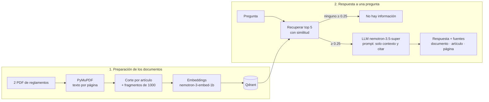

# Asistente RAG sobre los reglamentos de pregrado de EAFIT

Proyecto final de **SI3003 Inteligencia Artificial**, Universidad EAFIT, en la **Opción A: sistema RAG**.

[](https://colab.research.google.com/github/saracastrillons/rag-reglamentos-eafit/blob/main/rag_reglamentos_eafit.ipynb)

## Integrantes

- _Nombre 1_
- _Nombre 2_
- _Nombre 3_
- _Nombre 4_

## Problema

Los estudiantes de EAFIT tienen dudas frecuentes sobre normas académicas: cancelación de materias, promedios, materias perdidas, supletorios, reingresos y devoluciones de dinero. La información está en reglamentos extensos en PDF, difíciles de consultar rápido, y muchas veces terminan preguntando en pasillos o redes y reciben respuestas imprecisas.

El prototipo es un asistente que responde esas preguntas **solo** a partir de los reglamentos oficiales. Junto con cada respuesta muestra el documento, el artículo y la página de los fragmentos en que se apoya, y dice cuándo la información no está en los documentos.

**Por fuera del alcance:** casos personales que requieren datos del estudiante, trámites en línea, interpretación jurídica o decisiones oficiales, normas que no estén en los documentos cargados (calendario académico, valores de matrícula, parqueaderos) y la actualización automática de los reglamentos.

## Opción elegida y por qué

Elegimos **RAG** porque el conocimiento ya existe en documentos escritos y la tarea principal es encontrar y explicar lo que dicen, no hacer cálculos. RAG hace que el modelo responda con base en el texto oficial y no en su conocimiento general, que puede estar desactualizado o corresponder a otra universidad. Además, mostrar la fuente permite verificar cada respuesta contra el reglamento.

## Documentos

| Documento | Archivo en el repo | Páginas | Fuente oficial |
|---|---|---|---|
| Reglamento Académico de los Programas de Pregrado (con modificaciones hasta el acta 019 del 9 de diciembre de 2025) | [`docs/reglamento-academico-pregrado.pdf`](docs/reglamento-academico-pregrado.pdf) | 79 | [eafit.edu.co · reglamento académico de pregrado](https://www.eafit.edu.co/institucional/reglamentos/reglamento-academico-de-los-programas-de-pregrado) |
| Reglamento Económico de la Relación Académica del Estudiante con la Universidad, versión VI (noviembre de 2020) | [`docs/reglamento-economico.pdf`](docs/reglamento-economico.pdf) | 10 | [EAFIT · reglamento económico](https://universidadeafit.widen.net/s/wggqcsdnhf/reglamento_economico) |

Los dos son públicos y se descargaron el 5 de noviembre de 2026 desde la [página de reglamentos de EAFIT](https://www.eafit.edu.co/institucional/reglamentos/reglamentos).

## Arquitectura



## Herramientas

| Etapa | Herramienta |
|---|---|
| Extracción de texto por página | PyMuPDF |
| Fragmentación | Corte por artículo + `RecursiveCharacterTextSplitter` de LangChain (1000 caracteres, solapamiento de 150) |
| Embeddings | NVIDIA NIM `nvidia/nemotron-3-embed-1b` |
| Índice vectorial | Qdrant en memoria, distancia coseno |
| LLM | NVIDIA NIM `nvidia/nemotron-3.5-super-vl-120b-a12b`, sin razonamiento (el modelo del curso, `nemotron-3-super-120b-a12b`, daba error 404 para nuestra cuenta) |
| Orquestación | LangChain |
| Interfaz (opcional) | Gradio |

Partimos del notebook del curso `03_rag_workshop_papers_nvidia_nim_colab.ipynb` y le hicimos estos cambios:

1. **Fuente con artículo y página.** MarkItDown pierde los números de página, así que leemos con PyMuPDF página por página. El texto se corta primero por artículo y cada fragmento guarda en sus metadatos el documento, el número y nombre del artículo y la página.
2. **Fragmentos con sentido.** Un artículo trata un solo tema. Si es largo, se corta preferiblemente antes de un "Parágrafo". Cada fragmento empieza con un encabezado `[Documento · Artículo N: título]`.
3. **Contexto insuficiente en dos niveles.** Si ningún fragmento supera el umbral de similitud, el sistema responde sin llamar al LLM. Si alguno lo supera, el prompt obliga al modelo a responder una frase fija cuando los fragmentos no alcanzan, y las pruebas detectan esa frase.
4. **Respuesta con fuentes.** Cada respuesta muestra los fragmentos usados con documento, artículo, página, similitud y un extracto.

## Cómo ejecutarlo

### Opción 1: Google Colab (recomendada)

1. Abre el notebook con el botón **Abrir en Colab** de arriba.
2. Crea una clave gratuita en https://build.nvidia.com/.
3. En Colab abre el panel 🔑 **Secrets**, crea un secreto llamado `NVIDIA_API_KEY` con la clave y activa el acceso para el notebook.
4. Ejecuta *Entorno de ejecución → Ejecutar todas*. El notebook descarga los PDF del repositorio si no están.

### Opción 2: local

```bash
git clone https://github.com/saracastrillons/rag-reglamentos-eafit.git
cd rag-reglamentos-eafit
python -m venv .venv
.venv\Scripts\activate          # Windows  (en macOS/Linux: source .venv/bin/activate)
pip install -r requirements.txt
copy .env.example .env          # en macOS/Linux: cp .env.example .env
```

Pega tu clave en `.env` (`NVIDIA_API_KEY=...`) y abre el notebook con `jupyter notebook rag_reglamentos_eafit.ipynb`.

> **Seguridad:** la clave nunca va en el código ni en el repositorio. El notebook la lee desde los secretos de Colab, desde `.env` o la pide de forma oculta. El archivo `.env` está en `.gitignore`.

## Estructura

```
rag-reglamentos-eafit/
├── rag_reglamentos_eafit.ipynb   # notebook principal (Partes 0 a 7)
├── docs/                         # los dos reglamentos en PDF
├── resultados/                   # se genera al correr las pruebas (CSV y Markdown)
├── requirements.txt
├── .env.example
└── README.md
```

## Casos de prueba

Las respuestas esperadas salen de leer directamente el reglamento. El notebook (Parte 5) ejecuta los cinco casos, muestra las fuentes y guarda la tabla en `resultados/`. Además calcula dos comprobaciones objetivas: si recuperó el artículo esperado y si el sistema se abstuvo.

| # | Tipo | Pregunta | Resultado esperado | Fuente esperada |
|---|---|---|---|---|
| 1 | Habitual | ¿Qué porcentaje de los créditos matriculados puedo cancelar en un semestre y qué condiciones hay? | Hasta el 50 % de los créditos. La asignatura no debe haber sido evaluada en más del 75 %, la cancelación se hace dentro de la fecha del calendario y no se pueden cancelar prácticas ni asignaturas con matrícula condicional (salvo fuerza mayor). | Académico, Art. 50 |
| 2 | Habitual | ¿Qué pasa si pierdo la misma materia por tercera vez? | Cuarta matrícula obligatoria en el semestre siguiente, con matrícula condicional y máximo 12 créditos. No se puede cancelar en la 3.ª, 4.ª ni 5.ª matrícula. Si la pierde en la cuarta, queda retirado por rendimiento. | Académico, Art. 51 |
| 3 | Habitual | ¿Con qué promedio me retiran de la universidad por bajo rendimiento académico? | Primera matrícula, promedio semestral menor que 2.5. Segunda o tercera, semestral y acumulado menor que 2.8. Cuarta en adelante, menor que 3.0. | Académico, Art. 52 |
| 4 | Cruza los dos documentos | Si cancelo una materia durante la segunda semana de clases, ¿me devuelven el dinero? | Se puede cancelar (Art. 50), y el Art. 50 remite al Reglamento Económico. Devolución del 90 % antes de iniciar la 2.ª semana, del 75 % antes de terminarla y nada desde la 3.ª. Los de primer semestre no pueden retirar materias. | Académico, Art. 50 + Económico, Art. 17 |
| 5 | Límite (información ausente) | ¿Cuánto cuesta el parqueadero de la universidad para estudiantes? | Debe decir que la información no está en los reglamentos, sin inventar una tarifa. | Ninguna |

### Resultados obtenidos

Ejecución en Google Colab el 5 de noviembre de 2026 con `nemotron-3.5-super-vl-120b-a12b`, `K = 5` y `UMBRAL = 0.25`.

| # | Respuesta obtenida (resumen) | Fuentes usadas (similitud máx.) | ¿Recuperó el artículo esperado? | ¿Se abstuvo? | Valoración |
|---|---|---|---|---|---|
| 1 | Hasta el 50 % de los créditos. La asignatura no debe haber sido evaluada en más del 75 %, la cancelación va dentro de la fecha límite, no se pueden cancelar prácticas y no puede cancelar quien tiene matrícula condicional, salvo fuerza mayor ante el Comité de Casos. Cada afirmación cita el Art. 50. | Académico Art. 50 (0.59); Económico Art. 17 y 12 | Sí | No | **Correcta y completa.** Incluye las cinco condiciones del artículo y todas están respaldadas por el fragmento del Art. 50. |
| 2 | Debe matricularla por cuarta vez en el semestre siguiente, con matrícula condicional y máximo 12 créditos. No puede cancelarla durante la cuarta matrícula y, si la pierde, queda retirado por rendimiento académico. Cita el Art. 51. | Académico Art. 51 (0.49); Art. 52 y 53 | Sí | No | **Correcta, con una omisión menor.** No menciona que tampoco se puede cancelar en la 3.ª ni en la 5.ª matrícula (literal f), aunque estaba en el fragmento recuperado. |
| 3 | Primera matrícula, promedio semestral menor que 2.5. Segunda o tercera, semestral y acumulado menor que 2.8. Desde la cuarta, menor que 3.0. Cita el Art. 52. | Académico Art. 52 (0.63); Art. 61, 76, 101 y 58 | Sí | No | **Correcta.** Da los tres umbrales exactos. Omite la cuarta causal (perder una materia en cuarta matrícula), pero la pregunta era por el promedio. |
| 4 | Sí: si cancela antes de terminar la segunda semana, recibe una devolución o saldo a favor del 75 %. El saldo tiene vigencia de dos años y la cancelación debe registrarse en Admisiones y Registro. Cita el Art. 17 del económico. Cierra con una frase confusa diciendo que no encuentra qué pasa "exactamente durante la segunda semana". | Económico Art. 17 (0.61, cuatro de los cinco fragmentos), Económico Art. 3 | Parcial: faltó el Académico Art. 50 | No | **Parcialmente correcta.** El 75 % es correcto y está respaldado. Pero no usó el Reglamento Académico, omitió que los estudiantes de primer semestre no pueden retirar materias (estaba en el mismo fragmento) y añadió una duda innecesaria. Ver análisis. |
| 5 | "No encuentro información suficiente en los reglamentos para responder esa pregunta. El tema del costo del parqueadero no aparece en los fragmentos." | Económico Art. 15, 23 y preámbulo (0.26) | N/A | Sí | **Correcta.** Reconoció que no tenía la información y no inventó una tarifa. Pasaron el umbral tres fragmentos poco relacionados (0.25–0.26), así que la abstención la hizo el LLM y no el filtro. |

**Criterios de valoración:**
- **Relevancia:** ¿la respuesta atiende la pregunta?
- **Respaldo:** ¿cada afirmación aparece en los fragmentos mostrados?
- **Citas:** ¿el artículo y la página citados son correctos?
- **Abstención:** ¿se abstuvo solo cuando debía?

**Resumen:** 4 de 5 casos correctos y 1 parcial. Todas las citas apuntan al artículo correcto y no se encontraron afirmaciones inventadas. El sistema se abstuvo solo en el caso límite, que era donde debía hacerlo.

## Análisis de resultados

### Exploración del umbral (Parte 6)

| Tipo | Pregunta | Similitud máx. | Similitud mín. |
|---|---|---|---|
| Dentro del dominio | ¿Cuántas veces puedo matricular una misma asignatura? | 0.65 | 0.40 |
| Dentro del dominio | ¿Los exámenes supletorios tienen algún costo? | 0.50 | 0.35 |
| Fuera del dominio | ¿Cuál es la receta de la bandeja paisa? | 0.07 | 0.05 |
| Fuera del dominio | ¿Cuánto cuesta el parqueadero de la universidad para estudiantes? | 0.26 | 0.24 |
| Difícil | ¿Cuánto vale la matrícula de Ingeniería de Sistemas? | 0.28 | 0.25 |

Las preguntas que sí están en los reglamentos tienen fragmentos entre 0.50 y 0.65, y una pregunta totalmente ajena queda por debajo de 0.10. Con `UMBRAL = 0.25` el filtro descarta sin llamar al LLM las preguntas que no tienen relación con el tema. En cambio, las preguntas "del mundo universitario" que no están en los documentos (parqueadero, valor de la matrícula) quedan justo en el borde (0.25–0.28) y pasan al LLM. En ambos casos el modelo se abstuvo correctamente: en el caso difícil respondió *"No aparece el valor de la matrícula de Ingeniería de Sistemas"*, aunque los fragmentos hablaban de los componentes de la matrícula.

Subir el umbral a 0.30 bloquearía esos dos casos antes del LLM sin afectar las preguntas válidas observadas. Lo dejamos en 0.25 porque fragmentos relevantes de apoyo aparecen entre 0.26 y 0.28 (por ejemplo, el Art. 52 en el caso 2), y es preferible que decida el LLM a perder contexto útil.

### Limitación observada: un solo documento acapara la recuperación (caso 4)

La pregunta del caso 4 necesitaba los dos reglamentos, pero **cuatro de los cinco fragmentos recuperados fueron pedazos del mismo Art. 17 del Reglamento Económico**. El Art. 50 del Reglamento Académico, que regula la cancelación y remite al económico para la devolución, quedó por fuera. Como la búsqueda solo trae los `K = 5` fragmentos más parecidos, cuando un artículo largo está dividido en varios fragmentos casi iguales, estos ocupan todos los cupos.

Hubo además un problema de generación. El fragmento con la regla completa (*primer semestre no puede retirar materias; 90 % antes de iniciar la 2.ª semana; 75 % antes de concluirla*) sí estaba en el contexto, pero el modelo solo usó el 75 %. Además añadió una duda innecesaria sobre "exactamente durante la segunda semana". Aun así, la respuesta no inventó nada: todo lo que afirmó está respaldado.

**Mejoras propuestas:**
1. **Diversificar la recuperación con MMR** (*Maximal Marginal Relevance*, disponible en Qdrant/LangChain) o limitar a dos fragmentos por artículo. Así entran artículos y documentos distintos en vez de varias partes del mismo.
2. **Búsqueda híbrida (vectorial + BM25)**, como se vio en clase, para términos exactos como "Artículo 52", "matrícula condicional" o "UMES".
3. **Seguir las referencias internas:** el Art. 50 dice que la devolución se rige por el Reglamento Económico. Si se detecta esa referencia, se podría recuperar también el artículo citado.

### Otras limitaciones

- **Preguntas que dependen de la situación personal.** "¿Con qué promedio me retiran?" depende de en qué matrícula va el estudiante. El sistema da la regla general, pero no la aplica a un caso concreto.
- **Omisiones.** En los casos 2 y 3 el modelo dejó por fuera detalles que estaban en el contexto. La fidelidad es alta (no inventa), pero la completitud no está garantizada.
- **Vigencia.** Los reglamentos cambian por actas del Consejo Académico. El índice refleja la versión descargada el 5 de noviembre de 2026 y no se actualiza solo.
- **Disponibilidad de modelos.** El modelo usado en el curso (`nemotron-3-super-120b-a12b`) devolvía error 404 y otros modelos del catálogo ya estaban retirados (error 410). Por eso el modelo se deja como una constante fácil de cambiar en la Parte 0.

## Aviso

Este asistente orienta, pero no reemplaza a la Oficina de Admisiones y Registro ni constituye una interpretación oficial de los reglamentos.
